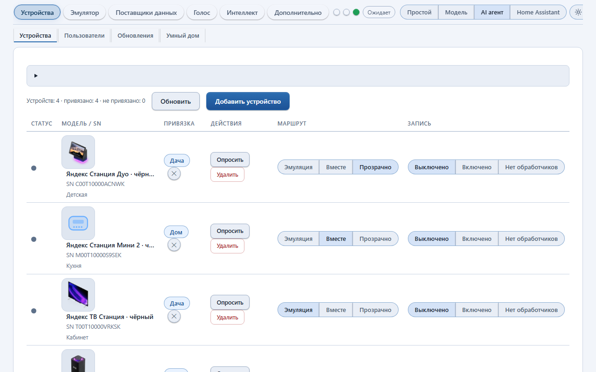
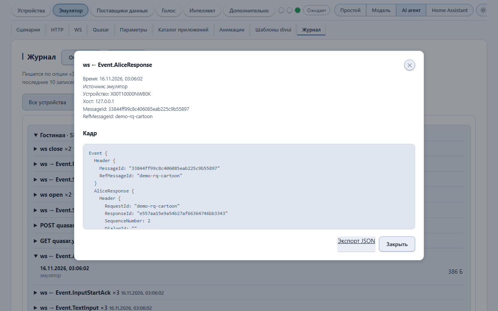
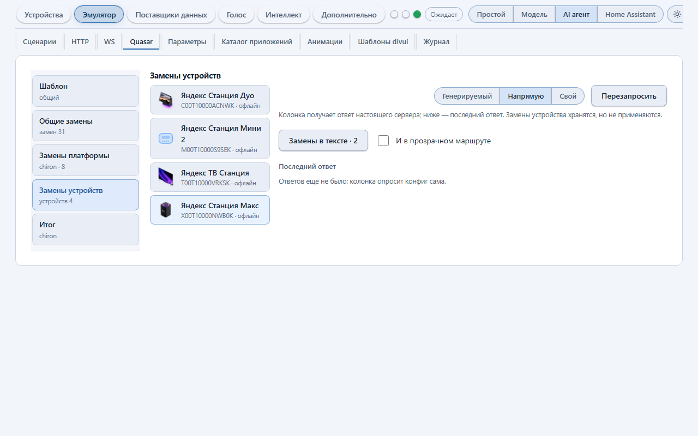
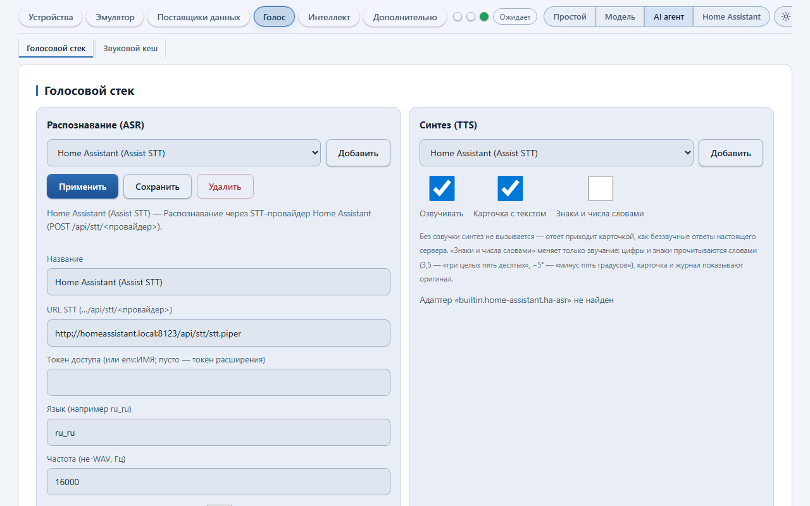
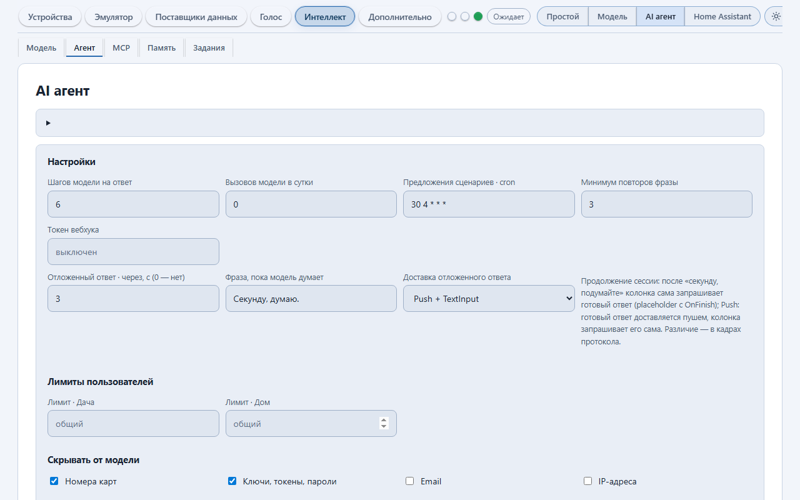
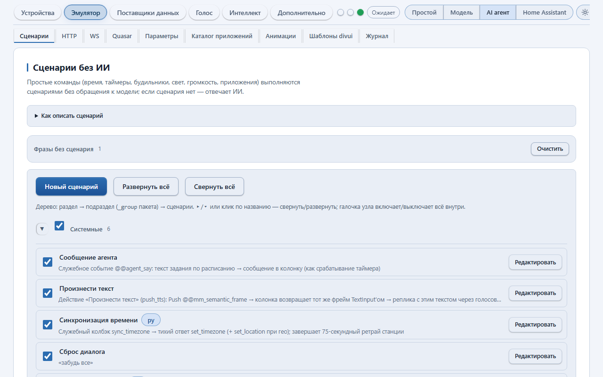

# alice-emulator

Обсуждение и вопросы — в Telegram-группе [t.me/yandex_iot](https://t.me/yandex_iot).

**Инструмент для исследования трафика умных колонок Яндекса** (станции с Алисой). Встаёт между
колонкой и облаком: показывает, что колонка отправляет и что получает, позволяет подменять отдельные
ответы и заменять часть серверной стороны локальной эмуляцией.

Проект исследовательский: это не замена облака Яндекса и не способ обойти его ограничения.



Все скриншоты — [docs/screenshots.md](docs/screenshots.md).

## Для чего

- Разобраться, как колонка общается с облаком: HTTP (Quasar, RPC), WebSocket и AAPI-сообщения
  голосового канала.
- Записывать и разбирать этот трафик: журнал по каждому устройству с расшифровкой protobuf.
- Ставить опыты: менять ответы облака, отвечать на запросы колонки локально и смотреть, как она
  реагирует.
- Писать свои обработчики, сценарии и расширения для изучения и автоматизации своих устройств.

## Чего здесь нет

- **Сертификатов.** Колонка ходит в облако по TLS; сертификат для имён Яндекса вам придётся выпустить
  и установить самостоятельно — в репозитории его нет.
- **Перенаправления трафика.** Эмулятор не меняет вашу сеть: чтобы колонка обращалась к нему, а не к
  облаку, DNS/роутер нужно перенастроить самостоятельно.
- **Входа в аккаунт и привязки колонки.** Эмулятор их не эмулирует: колонка должна быть уже привязана к
  аккаунту Яндекса штатным способом.
- **Разблокировки подписки.** Эмулятор не открывает платные функции и не снимает ограничения подписки.
- **Протокола и картинок устройств.** Описания протокола и изображения принадлежат Яндексу и в
  репозиторий не входят: протокол извлекается локально из файлов вашей станции при первом запуске,
  картинки скачиваются только с вашего согласия.

## Панель эмулятора

Вся работа — в панели **http://127.0.0.1/emulator/**. Разделы сгруппированы сверху; ниже — что
в каждой группе. Снимки всех разделов — [docs/screenshots.md](docs/screenshots.md).

- **Устройства.** Карточки колонок: модель и цвет распознаются по серийному номеру. Маршрут для
  каждого устройства — «Эмуляция» (отвечает эмулятор), «Гибрид» (эмулятор — где есть обработчик,
  остальное — в облако), «Прозрачно» (всё в облако, эмулятор наблюдает и при необходимости
  подменяет отдельные ответы) — и опция «Запись» трафика (всё / только то, что эмулятор не умеет
  обработать / выключено). Рядом: пользователи и их кабинеты, реестр умного дома из расширений,
  политика обновлений прошивки — разрешить, запретить или свой ответ при любом маршруте.


- **Эмулятор.** Сценарии без ИИ (JSON или py) с фразами-триггерами; промахи — «фразы без
  сценария» и запросы, на которые не нашлось ответа, собираются в каждом разделе. HTTP-эндпоинты
  (статический ответ, шаблон, py-скрипт — создаются из пойманного промаха), реестр WS/AAPI-сообщений
  с описаниями обработчиков и ручной отправкой директив. Конфиг Quasar по слоям (шаблон → общие
  замены → платформа → устройство; источник — генерируемый, «Напрямую» — ответ настоящего сервера
  с заменами, или свой сохранённый; незаполненный параметр или ошибка подстановки — закреплённое
  уведомление). Параметры с наследованием устройство → пользователь → платформа → сервер. Свой
  каталог приложений (APK, разделы, версии из манифеста). Анимации дисплеев колонок —
  фронтальная матрица, кольцо верха, 7-сегментные часы: рисование в редакторе, импорт
  .gif/.led/.scled, проигрывание на живую колонку. Шаблоны экранных директив divui с живым
  предпросмотром. Журнал трафика по устройствам: группировка одинаковых событий, карточка обмена
  с заголовками, телами и расшифровкой AAPI-кадров.





- **Поставщики данных** — источники данных кабинета (погода, напоминания и т. п.); группа
  собирается динамически из подключённых провайдеров.
- **Голос.** Голосовой стек — подключаемые адаптеры распознавания, синтеза речи и модели
  (локальные пакеты и облачные сервисы), состояния их серверов; для подписок — вход кодом
  устройства прямо из панели. Звуковой кеш реплик: фразы стандартных ответов и сценариев со
  статусом озвучки, перегенерация и прослушивание.



- **Интеллект.** Режимы: простой (фразы без сценария — ответы из пакета озвучки, модель не
  вызывается), языковая модель, ИИ-агент. У агента: инструменты (встроенные и внешние MCP-серверы,
  у каждого «Авто» или «Подтверждение»), долговременная память по пользователям (факты, сводки
  разговоров, пожелания к ответам), задания по расписанию — cron, интервал или разово, агенту или
  сценарию, сказать на колонку или положить во «входящие».



- **Дополнительно.** Расширения из каталога, zip или папки — сценарии, эндпоинты, действия,
  режимы «Интеллекта», обработчики AAPI на Python (пример — расширение Home Assistant);
  настройки сервера; лог событий сервера (ошибки HTTP и TLS-фронта, самообновление); проверка
  цепочки «аудио → распознавание → модель → озвучка» по частям и целиком.
- **Управление:** вход в панель по паролю, параметры кабинета, установка скриптом
  (`install.bat` / `install.sh`), самообновление по релизам, иконка в трее на Windows.



## Быстрый старт

Python 3.11+.

```powershell
python -m pip install -e ".[test]"
python -m server_emulator.server
```

Установка с нуля — `install.bat` / `install.sh`. На Windows — с иконкой в трее: `start.bat`. Панель:
**http://127.0.0.1/emulator/**. Порты по умолчанию — 443 (TLS) и 80, меняются в «Дополнительно →
Сервер». Папка данных — `--state <папка>` (по умолчанию `server_emulator/state/`, в Git не попадает).

Постоянная работа на Linux-сервере — служба systemd, обновление по кнопке из панели:
[docs/deploy.md](docs/deploy.md).

### Первый запуск

При первом запуске откроется окно «Настройка эмулятора»:

1. **Протокол** (обязательно) — `libquasar_daemons.so` из APK станции или zip с `.proto`/`.pb`.
   Разбирается локально, никуда не отправляется и после разбора удаляется.
2. **Картинки устройств** (необязательно) — скачиваются с сайта умного дома Яндекса после согласия с
   тем, что права на них принадлежат ООО «Яндекс».

Дальше — сертификат и перенаправление трафика колонки на компьютер с эмулятором:
[docs/setup.md](docs/setup.md).

## Тесты

```powershell
python -m pytest tests/ -q
```

Тесты используют только локальные серверы, без обращения к Яндексу. Тестам протокола нужны схемы:
задайте `ALICA_PROTOCOL_SOURCE=<libquasar_daemons.so или zip>`, без них такие тесты пропускаются.

## Документация

- [Архитектура](docs/architecture.md)
- [Карта архитектуры](docs/architecture-map.svg) и [карта сценариев](docs/scenario-map.svg)
- [Установка и настройка](docs/setup.md)
- [Развёртывание: служба systemd](docs/deploy.md)
- [Скриншоты интерфейса](docs/screenshots.md)
- [Контракты](docs/contracts/) — протоколы, сценарии, расширения, API

## Правовое

Проект независимый и не связан с ООО «Яндекс». «Яндекс», «Алиса», «Яндекс Станция» — товарные знаки их
владельцев. Используйте инструмент только со своими устройствами и аккаунтами.
