# Скриншоты интерфейса

Сняты на демо-данных (`tools/demo_state.py`): фиктивные пользователи «Дом» и «Дача», четыре
колонки разных моделей (серийники вымышленные, значения в данных — `example.test`, `192.0.2.x`,
`demo-…`). Никаких настоящих серийников, адресов и токенов на снимках нет.

## Устройства

Карточки колонок: модель и цвет распознаются по серийному номеру, у каждого устройства свой
маршрут («Эмуляция» / «Вместе» / «Прозрачно») и опция «Запись» трафика.

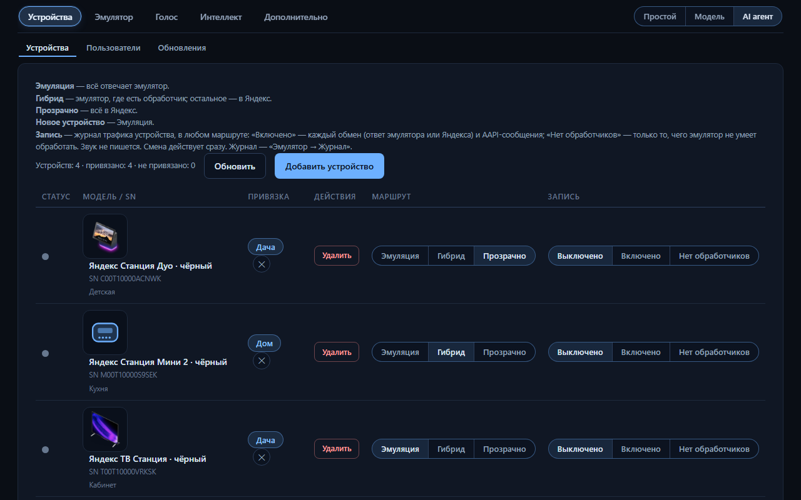

## Пользователи

Владельцы устройств; у каждого — кабинет с параметрами своего дома.

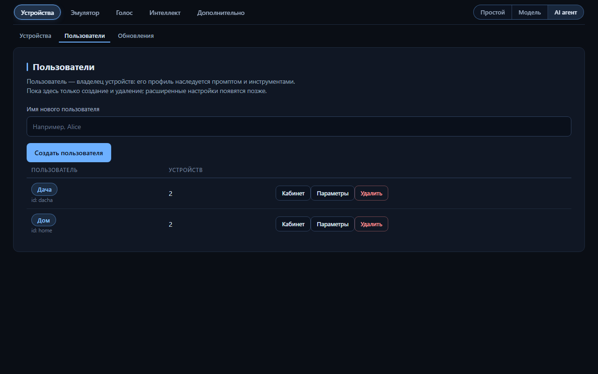

## Обновления · OTA

Политика обновлений прошивки по платформам и устройствам: разрешить, запретить, свой ответ.
Действует при любом маршруте устройства.

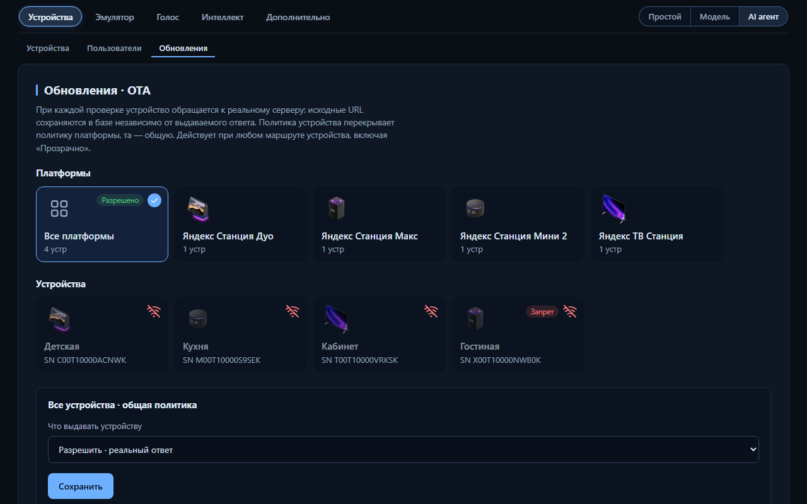

## Сценарии без ИИ

Библиотека сценариев (JSON или py) с триггерами-фразами; фразы, на которые не нашлось сценария,
собираются в «Фразы без сценария».

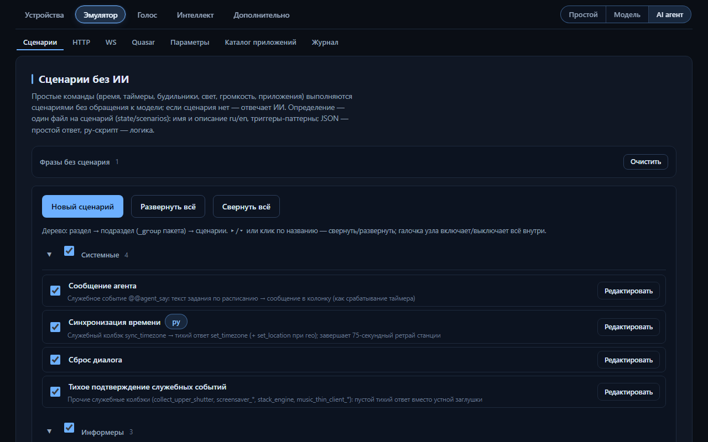

## HTTP

Каталог эндпоинтов (статический ответ, шаблон, py-скрипт) и встроенные ответы; промахи —
запросы колонки, на которые не нашлось обработчика.

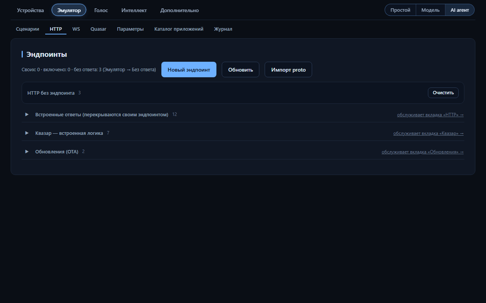

## WS

Протокольный слой колонки: реестр входящих AAPI-сообщений с описаниями обработчиков, служебные
колбэки и ручная отправка директив.

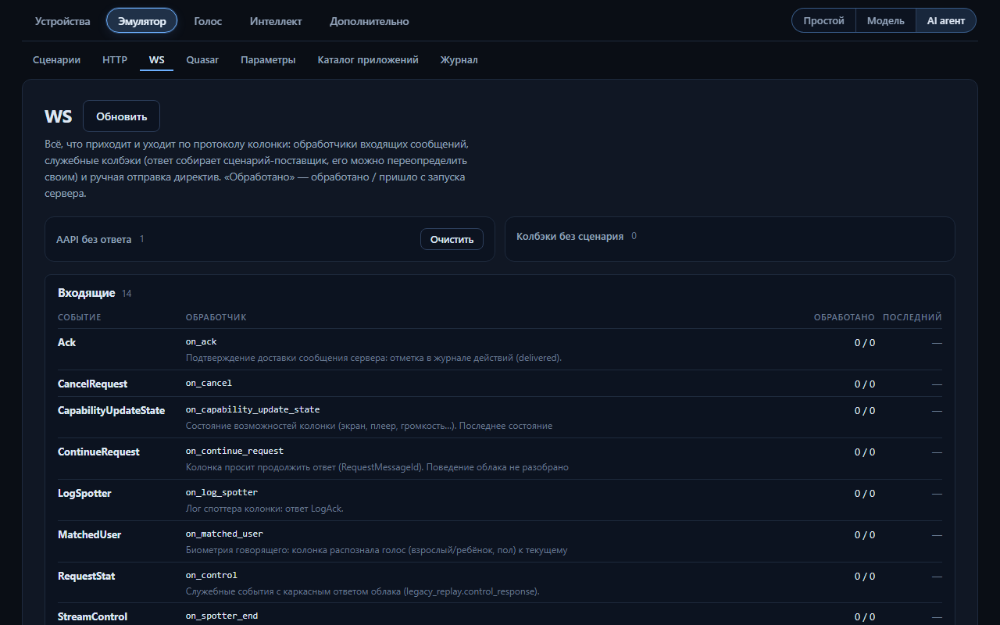

## Quasar

Переопределение sync-конфига по устройствам: генерируемый конфиг, «Напрямую» (ответ настоящего
сервера с заменами) или свой сохранённый.

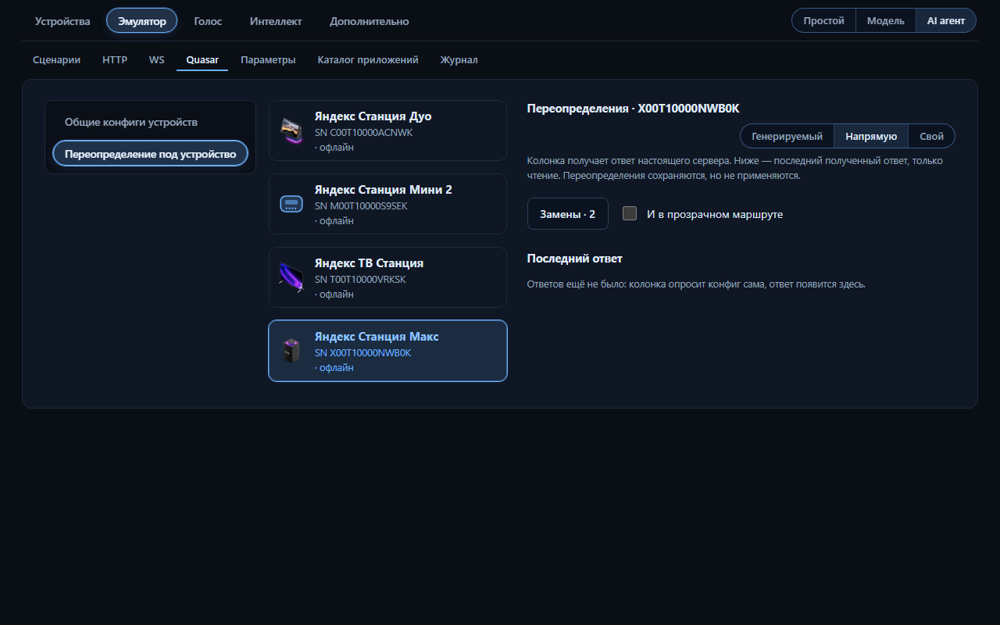

## Параметры

Каталог параметров с цепочкой наследования устройство → пользователь → платформа → сервер.

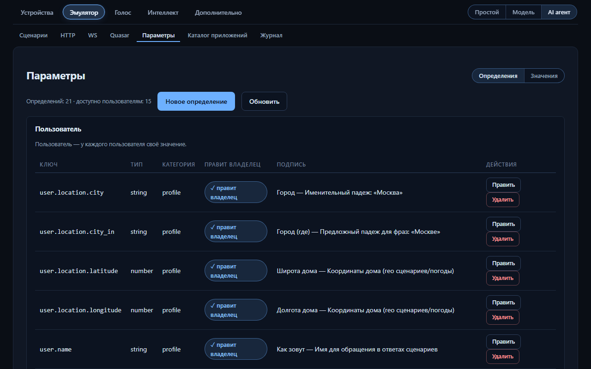

## Каталог приложений

Свои APK в каталоге Centaur: режимы «Напрямую / Вместе / Только свои», свои разделы, версия из
манифеста.

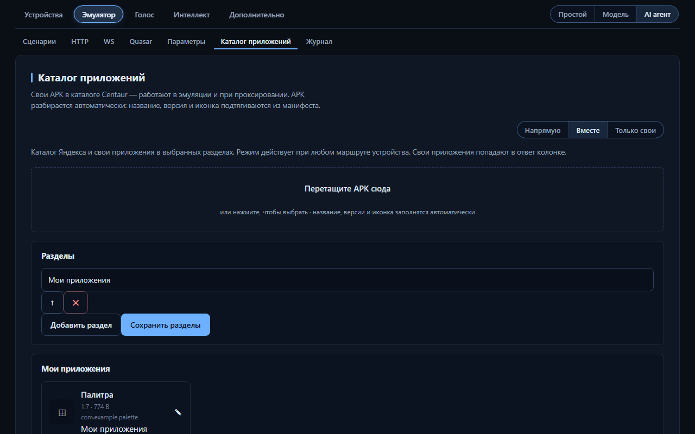

## Журнал

Трафик по устройствам: группы событий, карточка обмена с заголовками, телами и расшифровкой
AAPI-кадров.

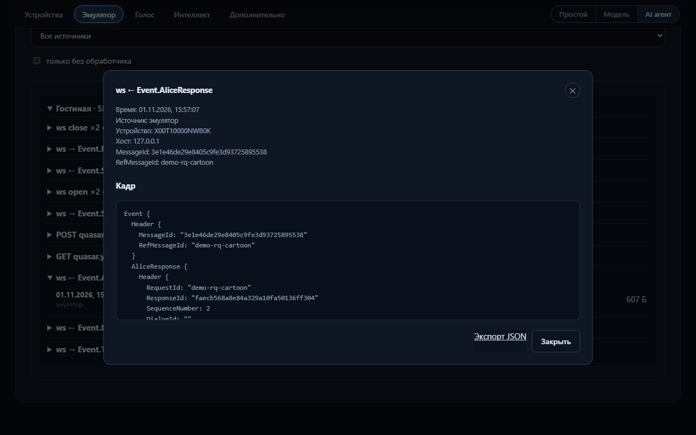

## Голосовой стек

Подключаемые адаптеры распознавания и синтеза речи (локальные и облачные), состояния серверов.

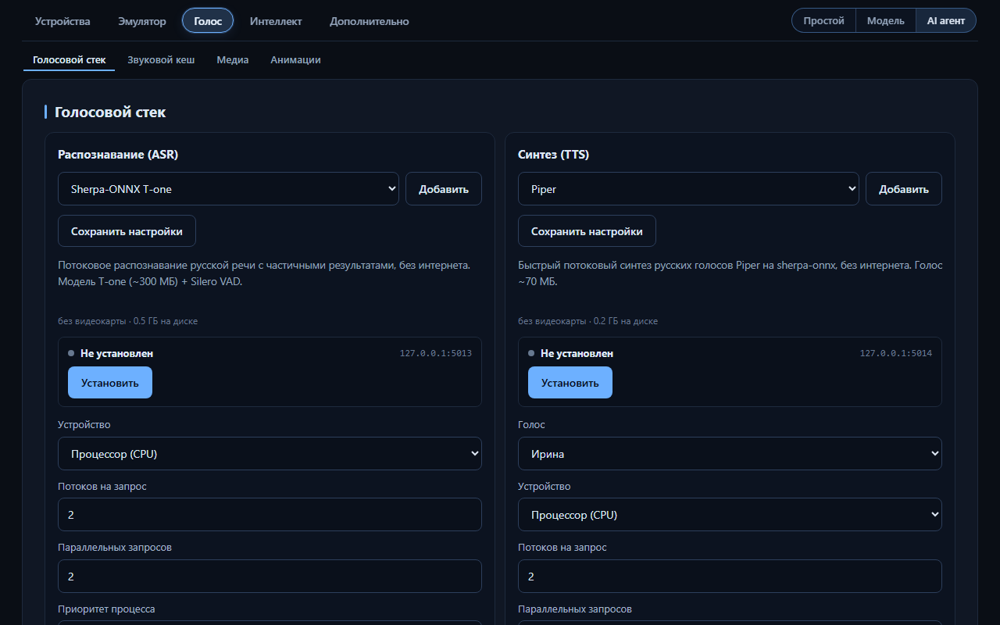

## AI агент

Режим «Интеллекта» с инструментами (MCP), памятью, подтверждениями действий и заданиями по
расписанию.

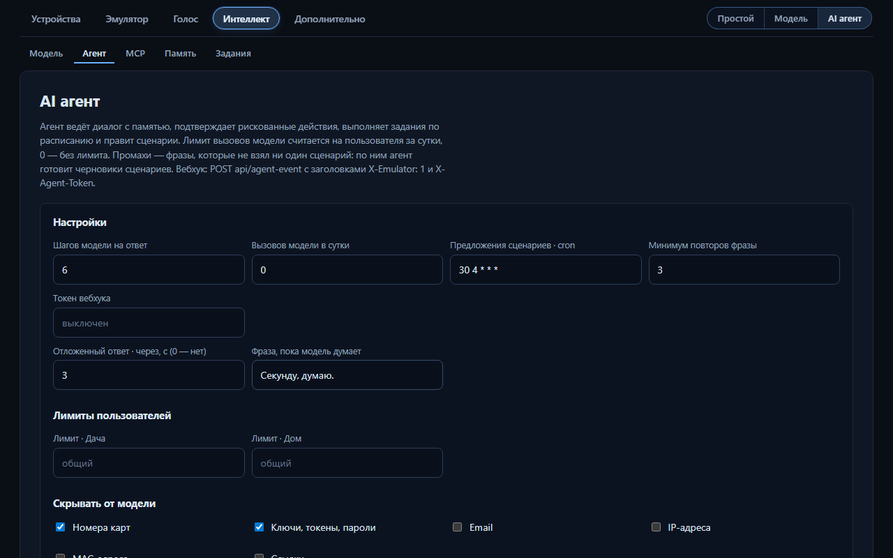

## Расширения

Установка расширений из каталога, zip или папки: сценарии, эндпоинты, действия, режимы
«Интеллекта».

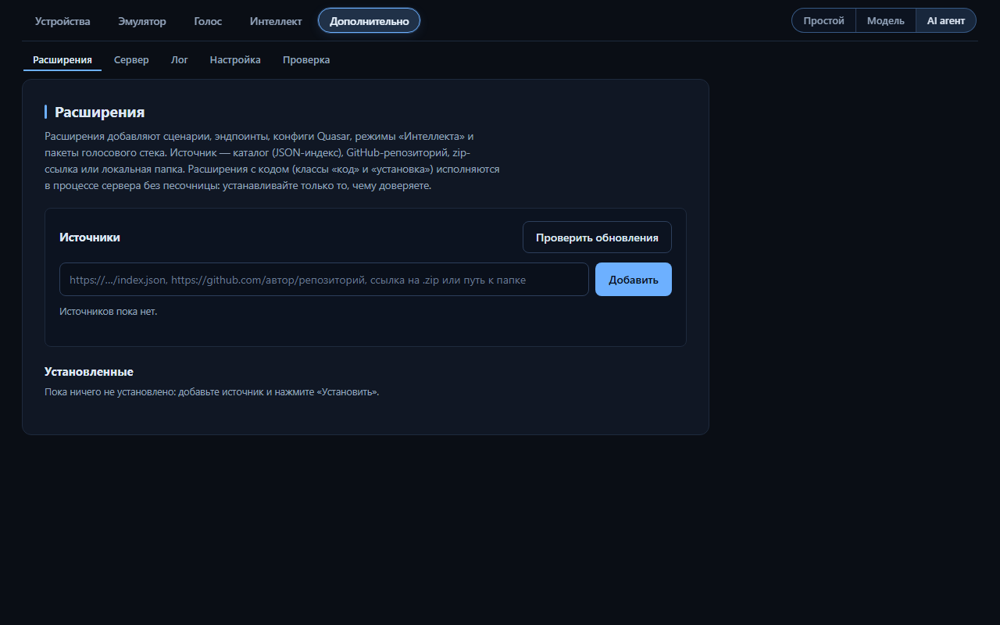

## Лог

Журнал событий сервера: ошибки HTTP и TLS-фронта, пересылка наверх, самообновление, неудачный
вход; хранение 3 дня.

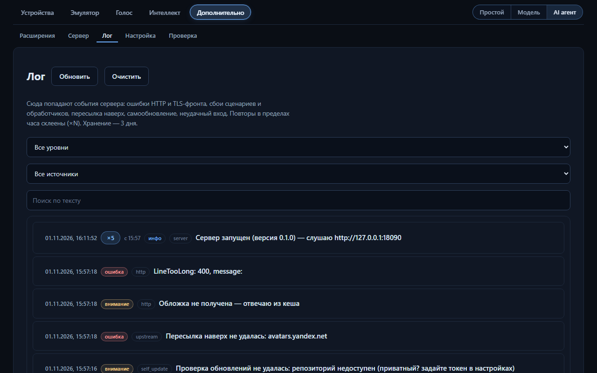

## Мобильная вёрстка

Панель на ширине 400px.

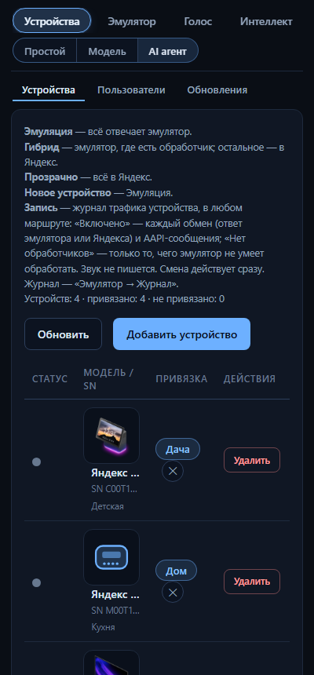

## Как переснять

```powershell
python tools/demo_state.py <папка>                                # демо-данные с нуля
python tools/readme_screenshots.py --state <папка> --out docs/img # снимки
```

Зависимости съёмки — вне проекта: `pip install playwright pillow` и `playwright install
chromium`. Скрипты используют только локальный сервер на 127.0.0.1:18090 и демо-данные; время на
снимках зафиксировано на момент генерации демо (`tools/demo.json`), поэтому повторный запуск даёт
те же кадры. Вкладка «Настройка» не снимается — на ней виден путь к папке данных.
